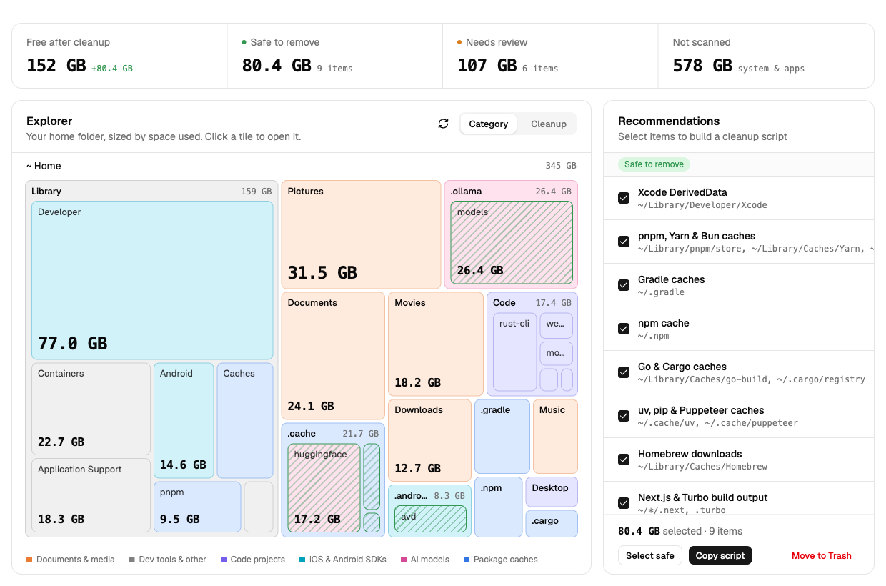
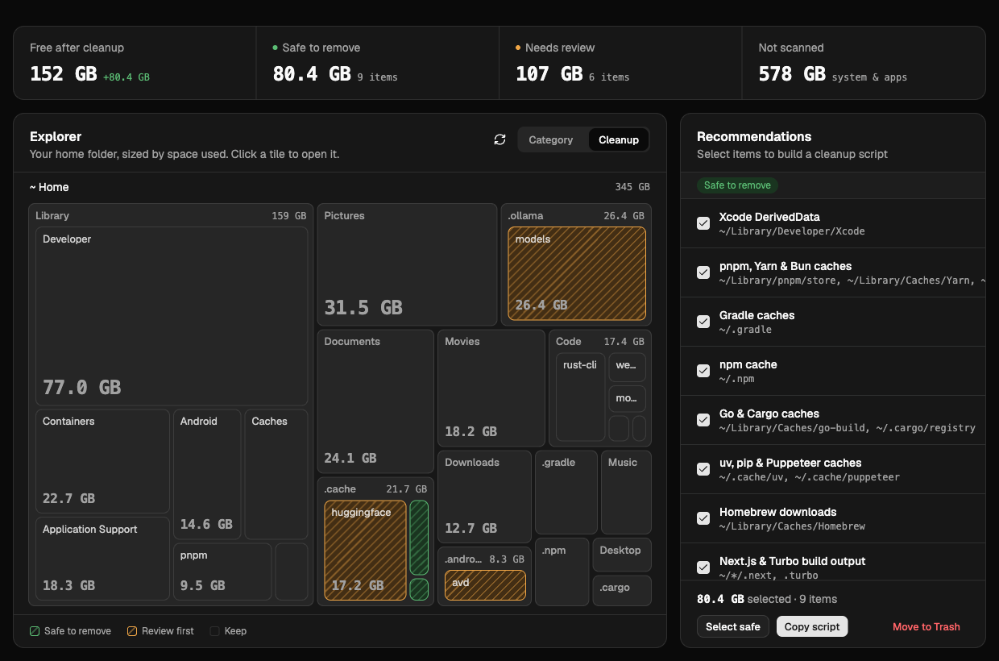

<p align="center">
  
</p>

<h1 align="center">DotClean</h1>

<p align="center">Find the caches, build output and model files quietly eating your disk, and clean them up knowing exactly what goes.</p>

<p align="center">
  <a href="https://github.com/kurerere/DotClean/releases/latest">Download</a> ·
  <a href="#cleanup-rules">Cleanup rules</a> ·
  <a href="#build-from-source">Build from source</a>
</p>

<p align="center">English · <a href="README.zh-CN.md">简体中文</a></p>

<p align="center">
  
</p>

---

After a while as a developer, `~/.npm`, `~/Library/Developer/Xcode/DerivedData`, `node_modules` in projects you stopped touching, Rust `target` folders and local LLMs easily add up to tens or hundreds of gigabytes. DotClean scans your home folder, splits what it finds into "safe to remove" and "review first", and shows how much space each one takes.

## Features

- **Fast home folder scan**: walks the tree in parallel and measures allocated disk blocks, so sparse files like `Docker.raw` report their real footprint. Symlinks are never followed and other volumes are skipped.
- **Treemap explorer**: drill into whichever folder is biggest; anything matched by a cleanup rule is highlighted.
- **Tiered recommendations**: "Safe to remove" is mostly caches that rebuild themselves; "Review first" is content you would have to download or rebuild again, such as models and SDKs.
- **Moves to the Trash, never deletes**: anything removed by mistake can be restored, and the space is reclaimed once you empty the Trash.
- **Cleanup script**: prefer to do it yourself? Copy an `rm -rf` script, read it, then run it.
- Only paths matched by the rules in the latest scan are accepted, so the UI cannot ask it to delete arbitrary locations.

Switch the explorer to the Cleanup view to see at a glance what can go (green) and what needs a look first (orange). The app follows the system dark mode:

<p align="center">
  
</p>

> Screenshots use demo data.

## Cleanup rules

**Safe to remove**

| Item | Location |
| --- | --- |
| npm cache | `~/.npm/_cacache`, `_npx`, `_logs` |
| pnpm, Yarn & Bun caches | `~/Library/pnpm/store`, `~/Library/Caches/Yarn`, `~/.bun/install/cache`, … |
| Next.js & Turbo build output | `.next`, `.turbo` in your projects |
| Gradle caches | `~/.gradle/caches`, `wrapper/dists`, `daemon` |
| Xcode DerivedData | `~/Library/Developer/Xcode/DerivedData` |
| uv, pip, Puppeteer & Playwright caches | `~/.cache/uv`, `~/.cache/pip`, `~/.cache/puppeteer`, … |
| Homebrew downloads | `~/Library/Caches/Homebrew` |
| Go & Cargo caches | `~/Library/Caches/go-build`, `~/.cargo/registry` |
| CocoaPods cache | `~/Library/Caches/CocoaPods` |

**Review first**

| Item | Location |
| --- | --- |
| Claude Code worktrees | `.claude/worktrees` in your projects |
| Android SDK & emulators | `~/Library/Android/sdk`, `~/.android/avd` |
| Ollama models | `~/.ollama/models` |
| Hugging Face & LM Studio models | `~/.cache/huggingface`, `~/.lmstudio/models` |
| Xcode device support & archives | `~/Library/Developer/Xcode/iOS DeviceSupport`, `Archives`, … |
| Rust build output | `target` folders containing `CACHEDIR.TAG` |
| `node_modules` in idle projects | projects untouched for 30+ days |

Items smaller than 1 MB are not listed.

## Install

Download from the [Releases](https://github.com/kurerere/DotClean/releases/latest) page:

- **macOS (Apple Silicon)**: `.dmg`
- **Windows (x64)**: `.msi` or `-setup.exe`

The builds are not code-signed yet:

- On macOS, the first launch says the developer cannot be verified. Open **System Settings → Privacy & Security** and click **Open Anyway**. If macOS instead says the app "is damaged and can't be opened", remove the download quarantine flag and open it again:

  ```sh
  xattr -cr /Applications/DotClean.app
  ```
- On Windows, if SmartScreen appears, click **More info → Run anyway**.

> DotClean is designed for macOS and most rules target the macOS folder layout. The Windows build runs, but few rules will match.

## Build from source

You need [Node.js](https://nodejs.org/), [pnpm](https://pnpm.io/) and [Rust](https://rustup.rs/), plus the platform dependencies listed in the [Tauri prerequisites](https://v2.tauri.app/start/prerequisites/).

```sh
pnpm install
pnpm tauri dev     # run in development mode
pnpm tauri build   # build installers
```

Stack: Tauri 2 and Rust for scanning and rule matching; React, Vite, Tailwind CSS and shadcn/ui for the interface.

## Releasing

Pushing a tag triggers GitHub Actions, which builds the macOS arm64 and Windows x64 installers and publishes them to Releases. For tags like `v1.2.3`, the app version is set to `1.2.3` automatically.

```sh
git tag v0.2.0
git push origin v0.2.0
```

## License

Original contributions are licensed under the [MIT License](LICENSE).
Copyright (c) 2026 kurerere.

Third-party code, assets and dependencies retain their own copyrights and license
terms. See [Third-party notices](THIRD_PARTY_NOTICES.md).
