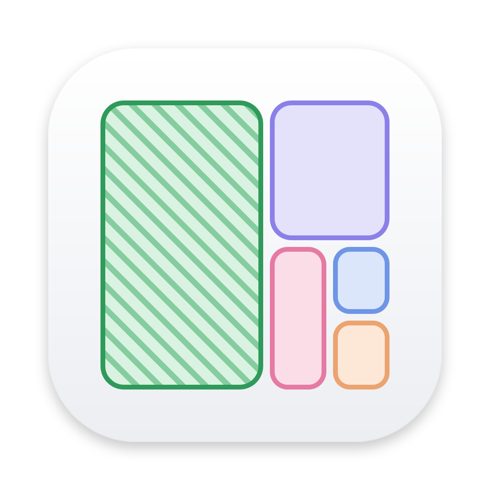

<p align="center">
  
</p>

<h1 align="center">DotClean</h1>

<p align="center">找出开发环境里悄悄吃掉磁盘的缓存、构建产物和模型文件，看清楚再清理。</p>

<p align="center">
  <a href="https://github.com/kurerere/DotClean/releases/latest">下载</a> ·
  <a href="#清理规则">清理规则</a> ·
  <a href="#从源码构建">从源码构建</a>
</p>

---

写代码久了，`~/.npm`、`~/Library/Developer/Xcode/DerivedData`、闲置项目里的 `node_modules`、Rust 的 `target`、本地大模型……这些东西加起来常常有几十上百 GB。DotClean 会扫描你的主目录，把它们按“可以放心删”和“删之前先看看”分开列出来，并显示各自占了多少空间。

## 功能

- **快速扫描主目录**：多线程遍历，按实际占用的磁盘块计算大小，所以 `Docker.raw` 这类稀疏文件显示的是真实占用；不跟随符号链接，也不跨卷扫描
- **矩形树图浏览**：逐层查看哪个文件夹最大，命中清理规则的部分会高亮标出
- **分级清理建议**：“可放心删除”的通常是能自动重建的缓存；“需要确认”的是删了要重新下载或重新构建的内容，比如模型和 SDK
- **移到废纸篓，不直接删除**：误删可以从废纸篓找回，清空废纸篓后才真正释放空间
- **生成清理脚本**：不想让应用动手的话，可以复制一份 `rm -rf` 脚本，自己检查后再执行
- 只接受扫描结果里规则匹配到的路径，前端无法让它删除任意位置

## 清理规则

**可放心删除**

| 项目 | 位置 |
| --- | --- |
| npm 缓存 | `~/.npm/_cacache`、`_npx`、`_logs` |
| pnpm、Yarn、Bun 缓存 | `~/Library/pnpm/store`、`~/Library/Caches/Yarn`、`~/.bun/install/cache` 等 |
| Next.js 与 Turbo 构建产物 | 项目中的 `.next`、`.turbo` |
| Gradle 缓存 | `~/.gradle/caches`、`wrapper/dists`、`daemon` |
| Xcode DerivedData | `~/Library/Developer/Xcode/DerivedData` |
| uv、pip、Puppeteer、Playwright 缓存 | `~/.cache/uv`、`~/.cache/pip`、`~/.cache/puppeteer` 等 |
| Homebrew 下载缓存 | `~/Library/Caches/Homebrew` |
| Go 与 Cargo 缓存 | `~/Library/Caches/go-build`、`~/.cargo/registry` |
| CocoaPods 缓存 | `~/Library/Caches/CocoaPods` |

**需要确认**

| 项目 | 位置 |
| --- | --- |
| Claude Code worktrees | 项目中的 `.claude/worktrees` |
| Android SDK 与模拟器 | `~/Library/Android/sdk`、`~/.android/avd` |
| Ollama 模型 | `~/.ollama/models` |
| Hugging Face 与 LM Studio 模型 | `~/.cache/huggingface`、`~/.lmstudio/models` |
| Xcode 设备支持文件与归档 | `~/Library/Developer/Xcode/iOS DeviceSupport`、`Archives` 等 |
| Rust 构建产物 | 项目中带 `CACHEDIR.TAG` 的 `target` |
| 闲置项目的 `node_modules` | 30 天以上没有改动的项目 |

小于 1 MB 的项目不会列出。

## 安装

在 [Releases](https://github.com/kurerere/DotClean/releases/latest) 页面下载：

- **macOS（Apple Silicon）**：`.dmg`
- **Windows（x64）**：`.msi` 或 `-setup.exe`

安装包目前没有签名：

- macOS 首次打开会提示无法验证开发者，到「系统设置 → 隐私与安全性」里点“仍要打开”
- Windows 弹出 SmartScreen 时，点“更多信息 → 仍要运行”

> DotClean 主要为 macOS 设计，大部分规则针对 macOS 的目录结构。Windows 版可以运行，但能匹配到的规则很少。

## 从源码构建

需要 [Node.js](https://nodejs.org/)、[pnpm](https://pnpm.io/) 和 [Rust](https://rustup.rs/)，另外按 [Tauri 的说明](https://v2.tauri.app/start/prerequisites/)安装各平台依赖。

```sh
pnpm install
pnpm tauri dev     # 开发模式
pnpm tauri build   # 打包安装包
```

技术栈：Tauri 2 + Rust 负责扫描和规则匹配，React + Vite + Tailwind CSS + shadcn/ui 负责界面。

## 发布新版本

推送 tag 就会触发 GitHub Actions，自动构建 macOS arm64 和 Windows x64 安装包并发布到 Releases。tag 形如 `v1.2.3` 时，安装包版本号会自动设为 `1.2.3`。

```sh
git tag v0.2.0
git push origin v0.2.0
```
